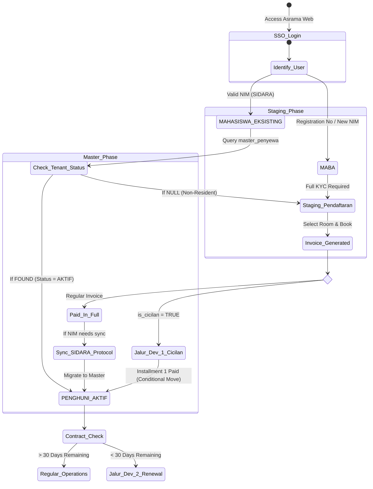

# Asrama Database Interaction & Scenario Mappings

> **Language / Pilihan Bahasa:** [🇮🇩 Bahasa Indonesia (Primary)](scenario-mappings.md) | 🇬🇧 **English Version**

This document defines the 5 primary database interaction scenarios for the Asrama (Dormitory) system. It outlines how the internal Asrama SQL Database routes different users based on their academic state (from SIDARA) and their tenancy state.

---

## 1. Cross-Reference Matrix: The 5 Scenarios

| Scenario | Target User | Database Interaction / Logic | UI / UX Routing |
| :--- | :--- | :--- | :--- |
| **1. Maba New (Onboarding)** | New Student (Registration No / New NIM) | **Check:** `master_penyewa` (NULL). **Check SIAKAD & SIDARA:** Has official NIM been issued? - If YES (`has_active_nim = true`): Show NIM Issued Modal & redirect to SSO. - If NO: Create `users` & `staging_pendaftaran`. | If official NIM detected, routed to **UBT SSO Login**. If not, routed to regular **Step 1-6 Onboarding** with e-KYC. |
| **2. Mahasiswa Eksisting (Non-Tenant)** | Existing Active Student (Valid NIM via SSO) | **Check:** `SIDARA_DB` (Must be Active). **Check:** `master_penyewa` (NULL). **Evaluate SIAKAD API Output:** - If fields complete (`is_api_fields_complete = true`): Skip profile form. - If incomplete: Prompt for missing fields. | **Fast-Track Onboarding** straight to **Step 2 (Room & Rent Selection)** if API data complete. Routed to **Step 1 (Complete Biodata)** if API data incomplete. |
| **3. Penghuni Aktif (Regular Tenant)** | Existing Room Inhabitant | **Check:** `master_penyewa` (FOUND, Status: AKTIF). **Check:** Contract `tanggal_selesai` > 30 days. | Routed to **Tenant Dashboard**. Access to complaints, monthly bills, gate QR codes. |
| **4. Cicilan Deposit (Installments)** | Maba or Eksisting (with financial aid) | **Check:** `master_pembayaran` (`is_cicilan = TRUE`). **Action:** Query `skema_cicilan` for installment progress. | Routed to **Installment Manager**. Dashboard highlights next due date and locks certain features until 100% paid. |
| **5. Draft Renewal** | Active Tenant (Contract near end) | **Check:** `master_penyewa` (Contract `tanggal_selesai` < 30 days). **Action:** Query `draft_renewal`. | Routed to **Renewal Pipeline**. User must sign the renewal agreement or initiate checkout before accessing regular features. |

---

## 2. Transition State Flow: Student to Room Inhabitant

